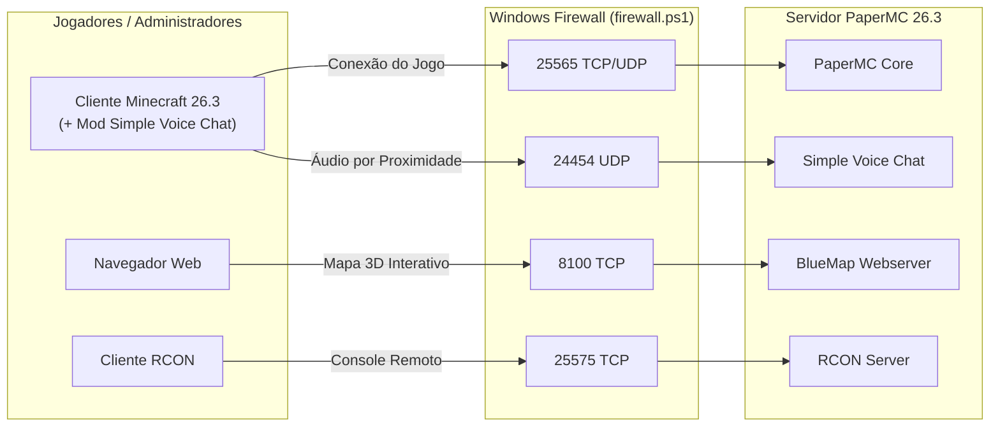

# ⛏️ Servidor Minecraft PaperMC 26.3 — Simple Server

Repositório oficial de configuração, scripts de automação e documentação técnica do servidor **Simple Server** (Minecraft `26.3`), construído sobre o motor de alta performance **PaperMC** com suporte a chat de voz por proximidade, mapa web 3D em tempo real e autenticação integrada.

---

## 📋 Índice

1. [Visão Geral e Especificações](#-visão-geral-e-especificações)
2. [Arquitetura e Portas de Rede](#-arquitetura-e-portas-de-rede)
3. [Plugins Instalados](#-plugins-instalados)
4. [Estrutura do Repositório](#-estrutura-do-repositório)
5. [Como Configurar e Iniciar o Servidor](#-como-configurar-e-iniciar-o-servidor)
6. [Otimizações de JVM (Aikar's Flags)](#-otimizações-de-jvm-aikars-flags)
7. [Guia Rápido de Comandos e Administração](#-guia-rápido-de-comandos-e-administração)
8. [Segurança e Versionamento](#-segurança-e-versionamento)

---

## 🖥️ Visão Geral e Especificações

| Componente | Especificação |
| :--- | :--- |
| **Motor do Servidor** | **PaperMC** `26.3-142` (`API 26.3.build.142-beta`) |
| **Versão do Minecraft** | `26.3` |
| **Java Runtime (JRE)** | **OpenJDK 25** (`25.0.1+8-LTS` 64-Bit Microsoft Build) |
| **Memória RAM Alocada** | `8 GB` (`-Xms8G -Xmx8G`) |
| **Núcleos/Threads JVM** | `2` (`-XX:ActiveProcessorCount=2`) |
| **Garbage Collector** | `G1GC` otimizado com **Aikar's Flags** |
| **Modo de Jogo / Dificuldade** | `Survival` / `Normal` |
| **Capacidade Máxima** | `20 jogadores` |
| **Distância de Visão / Simulação** | `12 chunks` (View) / `8 chunks` (Simulation) |
| **Modo de Autenticação** | `online-mode=false` (Protegido via **AuthMe** + **SkinsRestorer**) |

---

## 🌐 Arquitetura e Portas de Rede



### Tabela de Portas

| Porta | Protocolo | Serviço / Plugin | Exposição no Firewall | Descrição |
| :---: | :---: | :--- | :---: | :--- |
| `25565` | `TCP / UDP` | **Minecraft Server / Query** | ✅ Liberada (`firewall.ps1`) | Porta principal de conexão dos jogadores ao servidor. |
| `8100` | `TCP` | **BlueMap Webserver** | ✅ Liberada (`firewall.ps1`) | Interface web 3D do mapa em tempo real (`http://<IP>:8100`). |
| `24454` | `UDP` | **Simple Voice Chat** | ✅ Liberada (`firewall.ps1`) | Tráfego de pacotes de áudio (Opus VOIP) do chat por proximidade. |
| `25575` | `TCP` | **RCON** | 🔒 Restrita / Local | Administração remota via protocolo RCON. |

---

## 🧩 Plugins Instalados

O servidor conta com **10 plugins** principais (além do profiler **spark** integrado ao PaperMC):

| Plugin | Versão | Categoria | Descrição e Configuração Atual |
| :--- | :---: | :--- | :--- |
| **AuthMe Reloaded** | `6.0.1-b2770` | Segurança / Login | Autenticação in-game (`/register`, `/login`) com banco SQLite local e hash BCrypt. Protege contas devido ao `online-mode=false`. |
| **LuckPerms** | `5.5.71` | Permissões | Sistema de grupos, cargos e permissões com armazenamento local `H2` e integração direta ao Vault e TAB. |
| **Vault** | `1.7.3-b131` | API / Ponte | Camada de integração entre permissões (**LuckPerms**), chat e economia (**EssentialsX**). |
| **EssentialsX** | `2.22.0` | Utilidades / Economia | Comandos essenciais de sobrevivência, teleporte (`/tpa`, `/home`, `/spawn`, `/warp`), kits e economia básica. |
| **TAB** | `6.2.0` | Interface (UI) | Tablist customizada com cabeçalho `"RPG (Na Vdd N)"`, exibição de ping, consumo de RAM da JVM e ordenação por grupos (`owner`, `admin`, `mod`, `helper`, `builder`, `vip`, `default`). |
| **SkinsRestorer** | `15.12.6` | Cosmético | Restaura automaticamente skins oficiais para todos os jogadores e permite troca manual via `/skin`. |
| **BlueMap** | `5.28` | Mapa Web 3D | Renderiza o mundo em 3D no navegador na porta `8100` com atualização em tempo real via Server-Sent Events (`sse-enabled: true`). |
| **Simple Voice Chat** | `2.6.24` | Comunicação | Chat de voz por proximidade (`48 blocos` alcance normal, `24 blocos` sussurro), codec `VOIP`, suporte a grupos de voz e compatível com servidores multithread. |
| **CoreProtect** | `24.1` | Anti-Grief / Auditoria | Registra colocações/quebras de blocos, baús, explosões, líquidos e sessões em banco SQLite local, permitindo inspeção e rollback cirúrgico (raio padrão `10`, máx. `100`). |
| **Chunky** | `1.5.3` | Performance | Pré-geração de chunks para eliminar travamentos durante a exploração de novas áreas do mapa. |

---

## 📁 Estrutura do Repositório

```text
MinecraftServer/
├── abrir_firewall.bat          # Atalho que solicita privilégios de Admin (UAC) e executa o firewall.ps1
├── firewall.ps1                # Script PowerShell que cria as regras de entrada (25565, 8100, 24454)
├── run.bat                     # Inicializador do servidor em Batch com Aikar's Flags
├── run.ps1                     # Inicializador do servidor em PowerShell com Aikar's Flags
├── server.properties.example   # Modelo de propriedades do servidor (sem senhas sensíveis)
├── bukkit.yml                  # Configurações de spawn-limits e ticks do Bukkit
├── spigot.yml                  # Configurações de entidades, activation-range e seeds do Spigot
├── commands.yml                # Aliases de comandos customizados
├── help.yml                    # Tópicos de ajuda customizados
├── permissions.yml             # Permissões globais Bukkit (gerenciadas via LuckPerms)
├── eula.txt                    # Aceite do EULA da Mojang
├── server-icon.png             # Ícone 64x64 exibido na lista de servidores do Minecraft
├── config/
│   ├── paper-global.yml        # Configurações globais do PaperMC (chunk-system, packet-limiter, spark)
│   └── paper-world-defaults.yml# Configurações padrão de mundos do PaperMC (anti-xray, colisões, entidades)
└── plugins/                    # Configurações versionadas dos plugins (sem JARs ou bancos de dados)
    ├── AuthMe/
    ├── BlueMap/
    ├── Chunky/
    ├── CoreProtect/
    ├── Essentials/
    ├── LuckPerms/
    ├── SkinsRestorer/
    ├── TAB/
    ├── Vault/
    └── voicechat/
```

> **Nota:** Arquivos pesados ou sensíveis (`server.jar`, `plugins/*.jar`, `jre/`, `world/`, `bluemap/`, `logs/`, bancos `.db` e `server.properties`) são ignorados automaticamente pelo [`.gitignore`](.gitignore).

---

## 🚀 Como Configurar e Iniciar o Servidor

### 1. Pré-requisitos
- **Sistema Operacional:** Windows 10/11 ou Windows Server (64-bit).
- **Java:** **Java 25 (OpenJDK 25)** instalado no sistema ou extraído na pasta `./jre/bin/java.exe`.
- **Memória RAM:** Mínimo de `10 GB` no host (`8 GB` dedicados exclusivamente à JVM do servidor).
- **Binários necessários (não versionados no Git):**
  - Baixe o PaperMC `26.3` e salve na raiz como `server.jar`.
  - Coloque os arquivos `.jar` dos 10 plugins dentro da pasta `plugins/`.

### 2. Configurar o `server.properties`
Copie o arquivo de exemplo e defina suas senhas reais:

```powershell
Copy-Item server.properties.example server.properties
```

Edite o arquivo `server.properties` e altere:
- `rcon.password`: Defina uma senha forte para o RCON.
- `management-server-secret`: Defina uma chave secreta aleatória.

### 3. Liberar as Portas no Firewall do Windows
Na primeira execução, dê duplo clique em [`abrir_firewall.bat`](abrir_firewall.bat) (ou execute [`firewall.ps1`](firewall.ps1) como Administrador). O script irá liberar automaticamente:
- **TCP/UDP 25565** (Minecraft Paper Server)
- **TCP 8100** (Minecraft BlueMap Web)
- **UDP 24454** (Minecraft Simple Voice Chat)

### 4. Iniciar o Servidor
Você pode iniciar o servidor utilizando qualquer um dos dois scripts na raiz:

- **Via PowerShell (Recomendado):**
  ```powershell
  .\run.ps1
  ```
- **Via Prompt de Comando (CMD):**
  ```cmd
  run.bat
  ```

Ambos os scripts verificam automaticamente se existe um Java portátil em `.\jre\bin\java.exe` e, caso não encontrem, utilizam o comando `java` global do sistema.

---

## ⚡ Otimizações de JVM (Aikar's Flags)

Os scripts [`run.bat`](run.bat) e [`run.ps1`](run.ps1) iniciam o servidor com os parâmetros oficiais recomendados pelo PaperMC (**Aikar's Flags**), ajustados para **8 GB de Heap** e **2 núcleos de CPU**:

```text
-Xms8G -Xmx8G
-XX:ActiveProcessorCount=2
-XX:+UseG1GC
-XX:+ParallelRefProcEnabled
-XX:MaxGCPauseMillis=200
-XX:+UnlockExperimentalVMOptions
-XX:+DisableExplicitGC
-XX:+AlwaysPreTouch
-XX:G1NewSizePercent=30
-XX:G1MaxNewSizePercent=40
-XX:G1ReservePercent=20
-XX:G1HeapWastePercent=5
-XX:G1MixedGCCountTarget=4
-XX:InitiatingHeapOccupancyPercent=15
-XX:G1MixedGCLiveThresholdPercent=90
-XX:G1RSetUpdatingPauseTimePercent=5
-XX:SurvivorRatio=32
-XX:+PerfDisableSharedMem
-XX:MaxTenuringThreshold=1
```

---

## 🛠️ Guia Rápido de Comandos e Administração

### Jogadores
| Comando | Plugin | Descrição |
| :--- | :--- | :--- |
| `/register <senha> <senha>` | AuthMe | Registra uma conta no servidor na primeira entrada. |
| `/login <senha>` | AuthMe | Autentica o jogador ao entrar no servidor. |
| `/skin <nome_ou_url>` | SkinsRestorer | Altera a skin do jogador. |
| `/spawn`, `/home`, `/sethome` | EssentialsX | Teleporta para o spawn ou define/visita sua residência. |
| `/tpa <jogador>` | EssentialsX | Solicita teleporte até outro jogador. |
| Tecla `V` *(no cliente)* | Simple Voice Chat | Abre o menu do mod de voz (requer o mod instalado no cliente). |

### Administradores (OP / Staff)
| Comando | Plugin | Descrição |
| :--- | :--- | :--- |
| `/lp editor` | LuckPerms | Abre o editor web interativo de permissões e cargos. |
| `/co i` (`/co inspect`) | CoreProtect | Ativa o modo inspetor (clique em blocos/baús para ver quem alterou). |
| `/co rollback u:<nick> t:<tempo> r:<raio>` | CoreProtect | Reverte ações de um jogador (ex.: `/co rollback u:Griefer t:2h r:20`). |
| `/chunky radius <raio>` + `/chunky start` | Chunky | Inicia a pré-geração de chunks no raio definido. |
| `/bluemap` | BlueMap | Verifica o status da renderização do mapa 3D. |
| `/spark tps` / `/spark profiler` | spark | Monitora TPS, MSPT, uso de CPU/RAM e diagnostica gargalos. |

---

## 🔒 Segurança e Versionamento

- **Credenciais de Servidor:** Nunca remova `server.properties` do `.gitignore`. Utilize sempre o `server.properties.example` para documentar novas chaves de configuração.
- **Dados de Jogadores:** Os bancos SQLite/H2 (`authme.db`, `database.db`, `luckperms-h2-v2.mv.db`) e pastas de jogadores (`userdata/`, `playerdata/`) contêm hashes de senhas, IPs e inventários e são mantidos exclusivamente localmente fora do Git.
- **Aviso sobre `plugins/AuthMe/config.yml`:** O backend ativo é `SQLITE`. Caso futuramente altere para `MYSQL`, lembre-se de não versionar senhas de banco de dados em texto puro.
